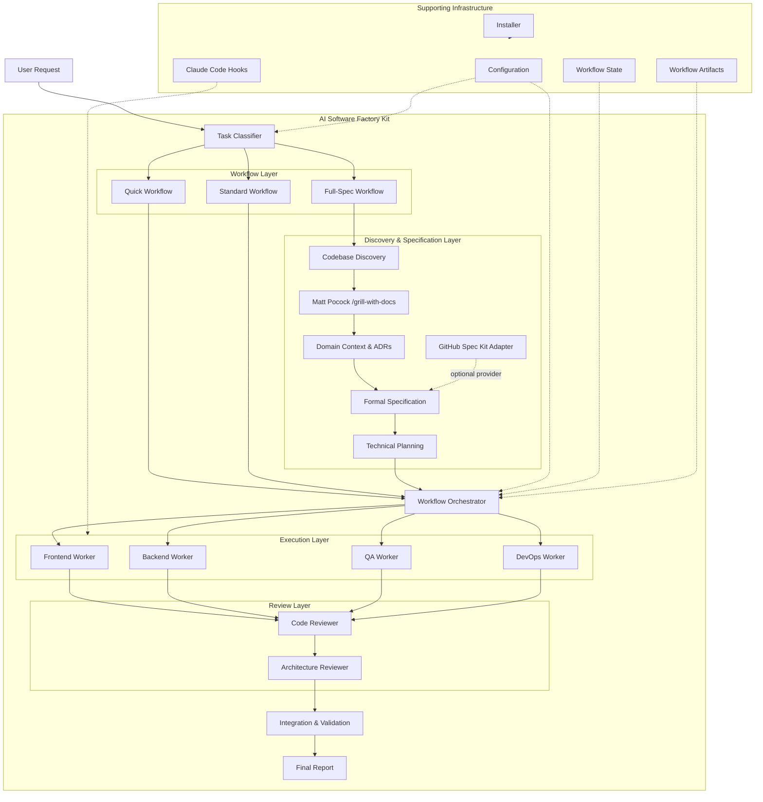
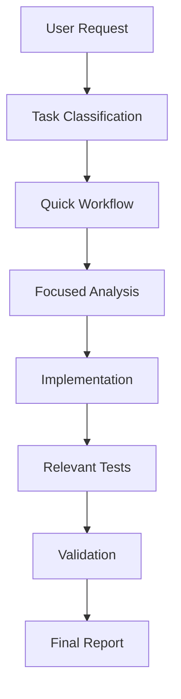
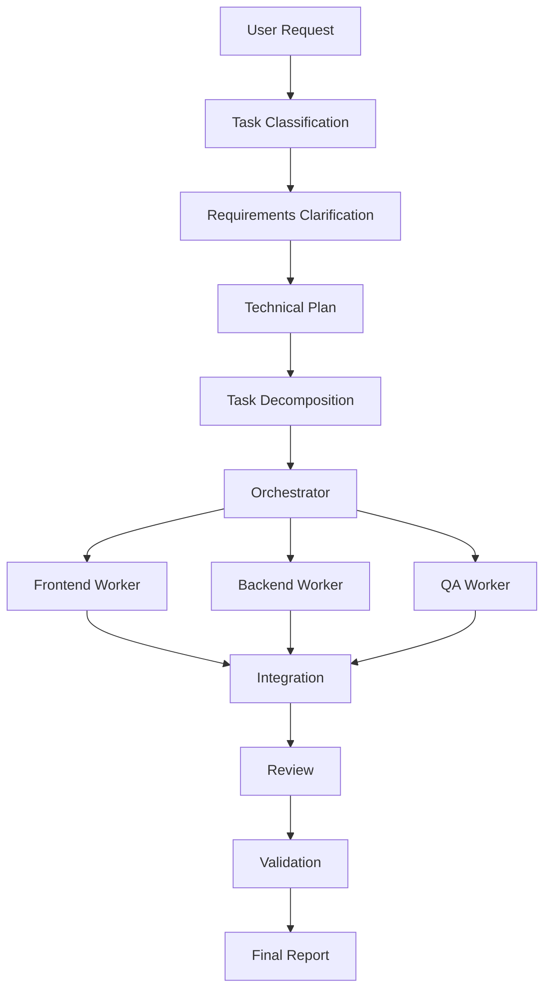
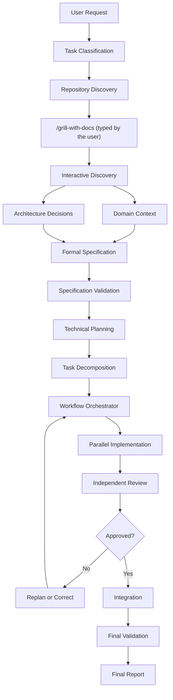
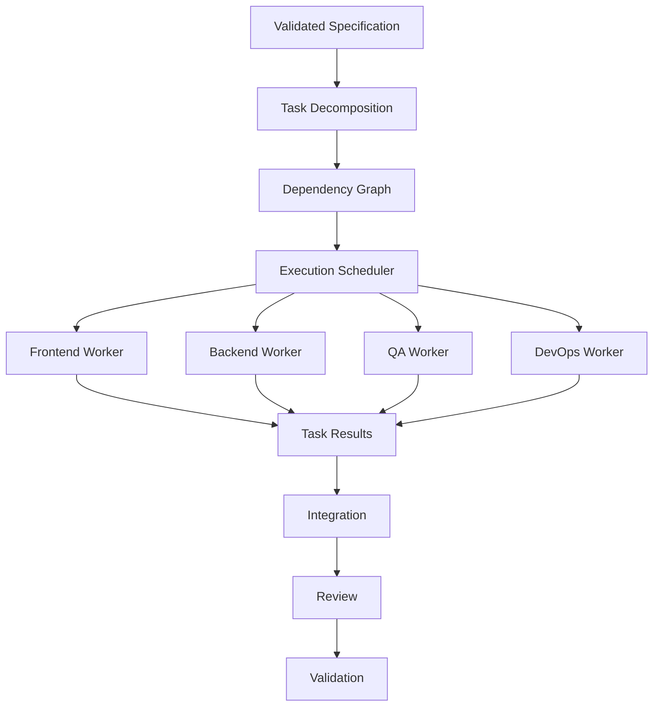
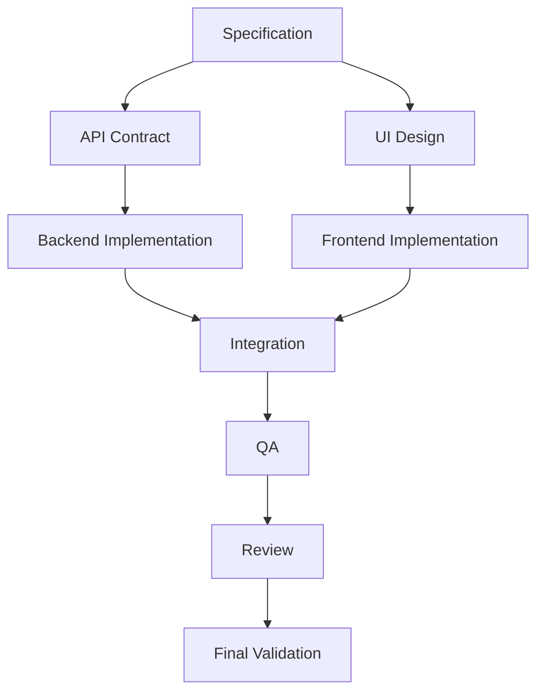
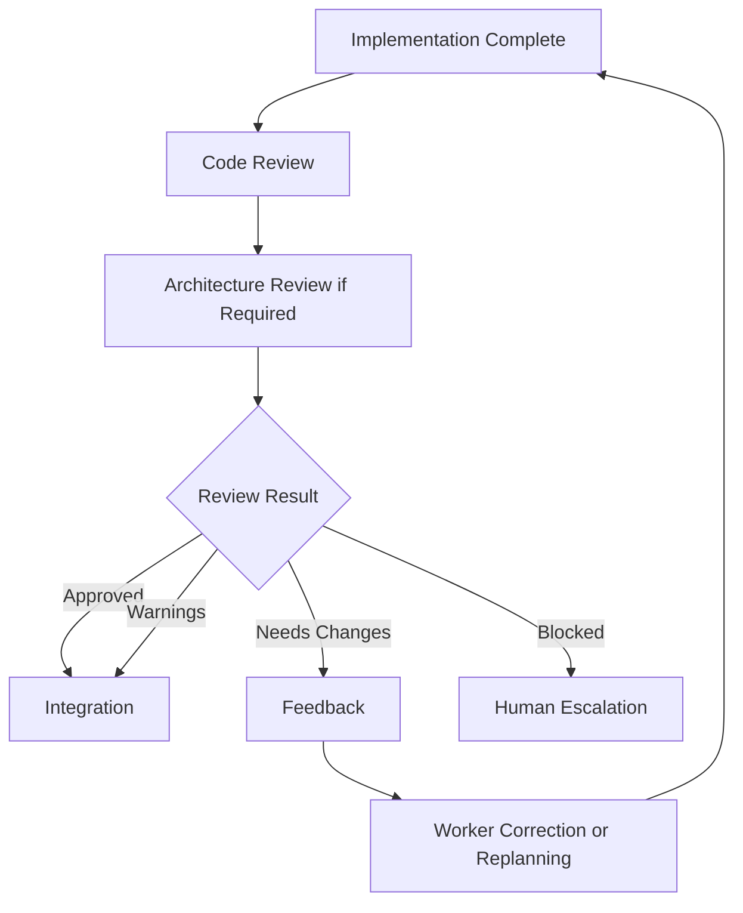
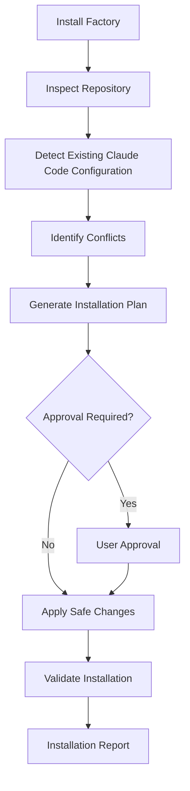

# AI Software Factory Kit — Architecture

## 1. Overview

The AI Software Factory Kit is a modular, reusable software development automation system designed primarily for Claude Code.

Its purpose is to transform software development requests into structured workflows that include:

- Task classification.
- Requirements discovery.
- Specification generation.
- Technical planning.
- Task decomposition.
- Orchestrated implementation.
- Quality assurance.
- Independent review.
- Integration and final validation.

The system is designed to be installed into existing repositories while preserving their configurations, conventions, and existing development workflows.

The initial implementation uses Claude Code's native capabilities rather than introducing an external multi-agent runtime.

The architecture must remain extensible to support alternative discovery tools, specification providers, models, and orchestration runtimes in the future.

---

## 2. Architectural Principles

The architecture follows these principles:

1. **Modularity:** Each component has a clearly defined responsibility.
2. **Native-first:** Prefer Claude Code's native capabilities over custom infrastructure.
3. **Separation of concerns:** Discovery, specification, planning, execution, and review are distinct stages.
4. **Reusability:** The kit can be installed into different repositories.
5. **Configurability:** Models, workflows, providers, and policies must be configurable.
6. **Dependency-aware execution:** Tasks execute according to their dependencies.
7. **Controlled parallelism:** Independent tasks may run concurrently when safe.
8. **Independent review:** Implementation and final review should not be performed exclusively by the same agent.
9. **Traceability:** Decisions, tasks, results, and validation must be documented.
10. **Safe installation:** Existing repository configurations must not be blindly overwritten.
11. **Graceful degradation:** Optional integrations must have documented fallback mechanisms.
12. **Human oversight:** High-impact or destructive operations require appropriate approval.

---

## 3. High-Level Architecture



---

## 4. Architectural Layers

### 4.1 Core Layer

The Core contains the reusable concepts and contracts of the Software Factory.

Responsibilities:

- Workflow definitions.
- Task models.
- Workflow states.
- Dependency models.
- Configuration contracts.
- Execution policies.
- Review policies.
- Artifact conventions.

The Core should not depend unnecessarily on a particular discovery skill, specification provider, or external orchestration runtime.

### 4.2 Claude Code Adapter

The Claude Code Adapter integrates the Factory with the native Claude Code environment.

It manages:

- Project instructions.
- Skills.
- Subagents.
- Rules.
- Hooks.
- Settings.
- Native delegation.
- Model configuration.

This layer translates the Factory's logical workflows into Claude Code-compatible instructions and execution mechanisms.

### 4.3 Workflow Layer

The Workflow Layer defines the three development modes:

- QUICK.
- STANDARD.
- FULL-SPEC.

Each workflow determines which stages are required, optional, or unnecessary.

The classifier selects the workflow based on task complexity, scope, risk, uncertainty, and architectural impact.

### 4.4 Discovery and Specification Layer

This layer transforms an initial request into implementation-ready requirements.

It consists of:

- Codebase Discovery.
- Discovery Provider.
- Context and Decision Documentation.
- Specification Provider.
- Technical Planning.

The layer must preserve the distinction between understanding a problem and producing a formal implementation specification.

### 4.5 Execution Layer

The Execution Layer contains the orchestrator and specialized workers.

Responsibilities:

- Task decomposition.
- Dependency management.
- Worker assignment.
- Parallel execution.
- Progress tracking.
- Failure handling.
- Result consolidation.

### 4.6 Review Layer

The Review Layer independently evaluates implementation quality and compliance.

It includes:

- Code Reviewer.
- Architecture Reviewer.

Architecture review is conditional on task complexity and architectural impact.

### 4.7 Supporting Infrastructure

Supporting infrastructure includes:

- Configuration.
- Workflow state.
- Artifacts.
- Hooks.
- Installer.
- Validation scripts.

These components support the main workflow without replacing the responsibilities of the orchestrator.

---

## 5. Workflow Architecture

### 5.1 QUICK Workflow

Designed for small, isolated tasks.



Characteristics:

- Minimal planning.
- No formal specification by default.
- No unnecessary discovery sessions.
- No unnecessary agent delegation.
- Focused testing and validation.

### 5.2 STANDARD Workflow

Designed for moderate features and multi-component changes.



Characteristics:

- Lightweight planning.
- Task decomposition.
- Parallel execution where safe.
- Independent review where appropriate.
- No mandatory formal discovery session.

### 5.3 FULL-SPEC Workflow

Designed for complex features, architectural changes, or uncertain requirements.



Characteristics:

- Structured discovery.
- Explicit requirement clarification.
- Domain documentation.
- Formal specification.
- Technical planning.
- Dependency-aware execution.
- Independent review.
- Final validation against original requirements.

---

## 6. Discovery and Specification Architecture

This is a critical architectural distinction.

### 6.1 Discovery Provider

The Discovery Provider is responsible for helping establish a shared understanding of the problem.

The preferred initial provider is:

**Matt Pocock's `/grill-with-docs` skill.**

The Factory must integrate the skill without duplicating its implementation.

The discovery provider is responsible for:

- Clarifying requirements.
- Identifying ambiguities.
- Exploring domain concepts.
- Investigating edge cases.
- Capturing relevant context.
- Recording decisions.
- Producing or updating discovery documentation.

### 6.2 Discovery Artifacts

Discovery may produce or update:

- `GLOSSARY.md` (or `GLOSSARY-MAP.md` for multi-context repositories). The current `/grill-with-docs` convention; earlier versions used `CONTEXT.md`.
- Domain documentation.
- Architecture Decision Records.
- Existing project documentation.

Artifacts must follow the repository's conventions.

Do not create duplicate documentation when equivalent information already exists.

### 6.3 Specification Provider

The Specification Provider converts discovery information into implementation-ready specifications.

It may use:

- Native Factory templates.
- GitHub Spec Kit.
- Future specification tools.

The provider must define a common logical contract regardless of the underlying tool.

### 6.4 Specification Artifacts

Typical specification artifacts include:

- Functional requirements.
- Non-functional requirements.
- Acceptance criteria.
- Edge cases.
- Constraints.
- Scope and exclusions.
- Testing expectations.

### 6.5 Technical Planning

Technical Planning transforms the specification into an executable plan.

It identifies:

- Architecture changes.
- Components affected.
- Technical decisions.
- Dependencies.
- Implementation tasks.
- Validation strategy.
- Risks.

Discovery, specification, and planning must remain separate logical stages.

---

## 7. Orchestration Architecture

The orchestrator coordinates all implementation tasks.



### Orchestrator Responsibilities

- Maintain workflow state.
- Understand the implementation plan.
- Assign tasks.
- Track dependencies.
- Coordinate workers.
- Manage parallel execution.
- Handle failures.
- Trigger reviews.
- Consolidate results.
- Escalate unresolved issues.

### Model Routing

Model selection must be configurable.

The orchestrator may use a more capable model for complex reasoning while workers use models appropriate to their tasks.

The architecture must not depend on fixed model names.

---

## 8. Worker Architecture

| Worker | Responsibility |
|---|---|
| Frontend Worker | UI, components, frontend behavior |
| Backend Worker | APIs, business logic, persistence |
| QA Worker | Test strategy, test execution, validation |
| DevOps Worker | CI/CD, infrastructure, deployment configuration |
| Code Reviewer | Independent implementation review |
| Architecture Reviewer | Architectural consistency and technical decisions |

Workers receive explicit task contracts and report their results.

Workers must not independently expand the workflow or redefine requirements without informing the orchestrator.

---

## 9. Dependency and Parallelization Architecture

Represent implementation tasks as a Directed Acyclic Graph (DAG).



The scheduler must:

- Identify independent tasks.
- Execute safe parallel work.
- Respect dependency constraints.
- Prevent conflicting modifications.
- Wait for required tasks before integration.
- Replan when dependencies fail.

Parallel execution is an optimization, not a mandatory requirement.

---

## 10. Review Architecture

The review system validates implementation against the original requirements.



### Review Criteria

- Requirement compliance.
- Correctness.
- Code quality.
- Testing.
- Security.
- Maintainability.
- Architectural consistency.
- Regression risks.

### Review Outcomes

- `APPROVED`
- `APPROVED_WITH_WARNINGS`
- `NEEDS_CHANGES`
- `BLOCKED`

Review iterations must be bounded.

---

## 11. State Management and Artifacts

Each workflow maintains a structured state.

Conceptually:

```ts
type WorkflowMode = "quick" | "standard" | "full_spec";

type WorkflowStatus =
  | "classifying"
  | "discovering"
  | "specifying"
  | "planning"
  | "executing"
  | "reviewing"
  | "replanning"
  | "integrating"
  | "completed"
  | "failed";

type TaskStatus = "pending" | "running" | "completed" | "failed" | "blocked";

interface WorkflowTask {
  id: string;
  description: string;
  role: string;
  dependencies: string[];
  status: TaskStatus;
  result?: string;
}

interface SoftwareFactoryWorkflow {
  id: string;
  mode: WorkflowMode;
  status: WorkflowStatus;
  tasks: WorkflowTask[];
  reviewAttempts: number;
}
```

This is a conceptual model. The implementation may adapt it to Claude Code's native capabilities.

### Artifact Lifecycle


Artifacts must support traceability and workflow recovery.

---

## 12. Claude Code Integration Architecture

The kit should use Claude Code's native capabilities.

| Claude Code capability | Software Factory responsibility |
|---|---|
| `CLAUDE.md` | Global and project-level guidance |
| Skills | Reusable workflows and domain procedures |
| Subagents | Specialized workers and reviewers |
| Hooks | Deterministic validation and lifecycle automation |
| Rules | Coding, testing, security, and workflow standards |
| Settings | Configuration and permissions |
| Native delegation | Agent coordination |
| Git | Version control and change management |

Use current supported conventions.

Do not implement custom infrastructure where Claude Code already provides an appropriate mechanism.

The architecture must distinguish between logical components and physical implementation.

For example, a logical workflow scheduler does not necessarily require a custom scheduler process.

---

## 13. Installation Architecture

The kit must be installable into existing repositories.



### Installer Responsibilities

- Detect existing configuration.
- Preserve project instructions.
- Avoid overwriting existing skills and agents.
- Merge configuration carefully.
- Identify conflicts.
- Support modular installation.
- Validate installed components.
- Document changes.

Installation must be safe, reversible where practical, and transparent.

---

## 14. Configuration Architecture

Configuration should control:

- Workflow classification.
- Model routing.
- Worker definitions.
- Review policies.
- Retry limits.
- Parallelization.
- Discovery providers.
- Specification providers.
- Hooks.
- Validation commands.
- Permissions.

Configuration must be validated before execution.

The Factory must support sensible defaults while allowing repository-specific customization.

---

## 15. Security Architecture

Security applies across all layers.

Key principles:

- Least privilege.
- Respect Claude Code permissions.
- Protect secrets.
- Avoid destructive operations without approval.
- Avoid unauthorized production deployment.
- Treat external content as untrusted.
- Validate commands and configuration.
- Limit worker scope where supported.
- Document security limitations.

---

## 16. Extensibility

The architecture must support future extensions without requiring a redesign.

Potential future extensions:

- Alternative discovery skills.
- Alternative specification providers.
- Additional worker roles.
- Different model providers.
- External multi-agent orchestration.
- Additional validation systems.
- Additional project types.

The initial version must remain focused on Claude Code native capabilities.

---

## 17. Architectural Decision Summary

| Decision | Rationale |
|---|---|
| Claude Code native-first | Minimize infrastructure and maximize compatibility |
| Modular kit | Reusable across repositories |
| Three workflow modes | Match process rigor to task complexity |
| `/grill-with-docs` as discovery provider | Reuse specialized discovery capabilities |
| Separate discovery and specification | Avoid conflating domain understanding with implementation requirements |
| GitHub Spec Kit as optional provider | Preserve flexibility and avoid mandatory dependency |
| Orchestrator with specialized workers | Enable structured delegation |
| DAG-based dependencies | Support safe parallel execution |
| Independent review | Improve quality and reduce self-approval |
| Bounded review loops | Prevent infinite iteration |
| Safe installer | Preserve existing repository configuration |
| Configurable models | Avoid hardcoded provider assumptions |
| Future runtime extensibility | Enable evolution beyond native Claude Code |

---

## 18. Final Architecture Goal

The AI Software Factory Kit should not become a monolithic skill that attempts to perform every responsibility itself.

It should be a **modular orchestration system** that coordinates specialized skills, agents, tools, workflows, and validation mechanisms.

Its core value is the integration of these components into a coherent, safe, documented, and repeatable software development process.

The architecture must remain understandable, maintainable, and extensible as the ecosystem evolves.

---

## 19. Physical Implementation Mapping

How the logical components above map onto Claude Code mechanisms, as verified in `docs/research/claude-code-capabilities.md`. Details and data shapes are in `docs/contracts/`; decisions are in `docs/adr/`.

| Logical component | Physical implementation | Decision |
|---|---|---|
| Kit distribution | Claude Code plugin `factory` in `plugins/factory/`, listed in this repo's `.claude-plugin/marketplace.json` | ADR-0001 |
| Core (definitions, schemas, policies) | `plugins/factory/core/` (JSON schemas, `defaults.json`, templates) | — |
| Deterministic logic (state, DAG, validation, installer planning) | Zero-dependency Node scripts in `plugins/factory/lib/`, exposed via `plugins/factory/bin/` | ADR-0002 |
| Classifier, workflows, orchestrator, workflow scheduler | Skills running in the **main conversation**; no scheduler process | ADR-0003 |
| Workers and reviewers | Plugin subagents without the `Agent` tool | ADR-0003 |
| Model routing | Config tiers → alias passed per Agent call | ADR-0004 |
| Discovery provider | User-invoked `/grill-with-docs`; native fallback skill | ADR-0005 |
| Specification provider | Local templates or Spec Kit (specify/clarify/plan only) | ADR-0006 |
| Parallel execution | Disjoint file scopes in the shared checkout; worktrees opt-in | ADR-0007 |
| Workflow state and artifacts | `.factory/workflows/<id>/` in the target repo | ADR-0008 |
| Rules / project instructions | Plugins cannot ship rules: optional `.claude/rules/factory-workflow.md` written by `init` | ADR-0001 |
| Hooks | Plugin `hooks/hooks.json`; inert unless a Factory workflow is active | — |
| Installer | `factory:init` skill + receipt `.factory/install.json` | ADR-0001 |

Two corrections were made to this document after verification: discovery produces `GLOSSARY.md` rather than `CONTEXT.md`, and Spec Kit is an alternative specification provider rather than a sequential stage after the specification.

