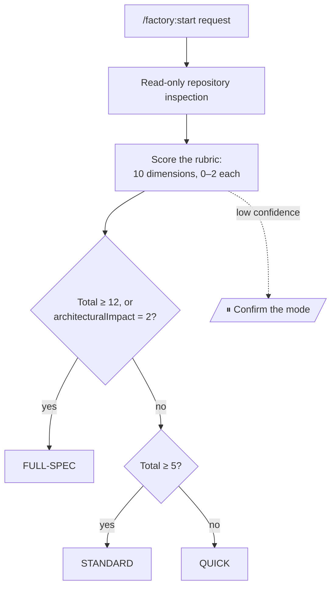
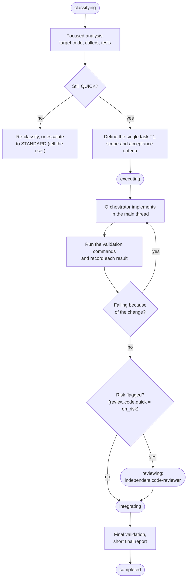
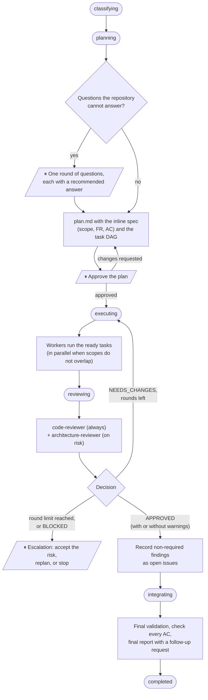
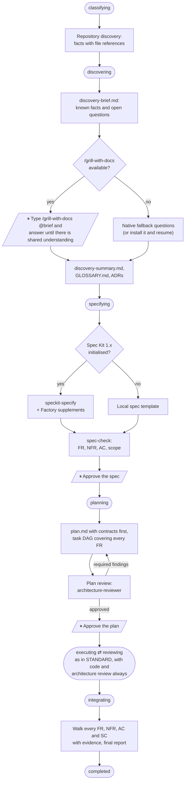
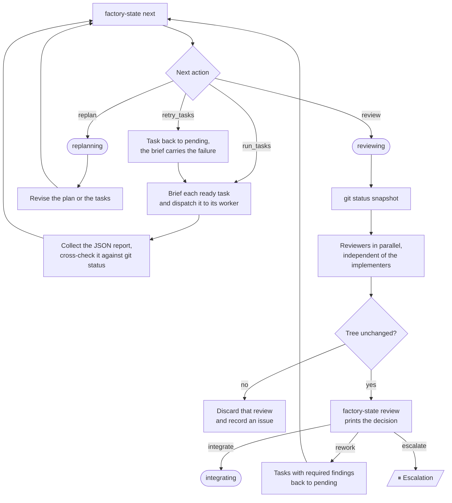
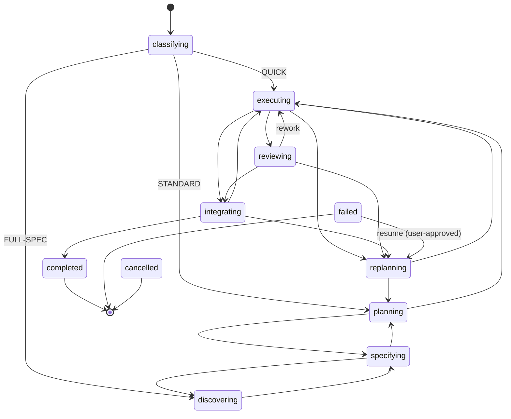

# Workflow diagrams

These diagrams follow the runtime procedures in `plugins/factory/core/workflows/` (`quick.md`, `standard.md`, `full-spec.md`, `execution.md`, `review.md`). If a diagram and a procedure disagree, the procedure is right.

**Legend**
- Rounded boxes are workflow **statuses**, as stored in the manifest.
- ⏸ marks a **pause for you**. The workflow records `blockedOn`, tells you exactly what it needs, and you continue with `/factory:resume [id] <answer>`.
- Any stage can also pause when it needs a decision that is not shown here, for example a command that needs your approval or a guard denial.

## 1. Classification: which mode runs

- The thresholds and the escalation dimensions come from `classification` in the config. The defaults are shown above.
- `--mode quick|standard|full_spec` forces a mode, and the forced mode is recorded with its reason.
- Uncertainty counts only when the repository cannot resolve it. A request that states its decisions scores lower: in Phase 9, the same feature scored FULL-SPEC 15 when worded vaguely and STANDARD 10 once its decisions were stated.

## 2. QUICK

Small, isolated changes. There is no plan document and no delegation: the orchestrator implements the change itself.

- Escalation after execution has started goes through `replanning → planning` with `--mode standard`.
- Because the orchestrator implements, a review, when one is required, must go to `factory:code-reviewer`. The orchestrator never reviews its own work.

## 3. STANDARD

Moderate features that touch several files or components. A light plan, workers for the tasks, and an independent review.

- Execution and review are detailed in §5.
- The round limit is `review.maxIterations`, 3 by default.
- An acceptance criterion that is not met blocks completion unless you accept it.

## 4. FULL-SPEC

Architectural, cross-domain or uncertain work. Discovery comes before specification, specification before planning, and planning before any code. **Product code is not changed before you approve the plan.**

- Discovery may write domain docs (`GLOSSARY.md`, ADRs) and nothing else.
- Only you can start `/grill-with-docs`, which is why discovery always pauses.

## 5. Execution and review loop (STANDARD and FULL-SPEC)

- A failed task is retried up to `execution.maxTaskAttempts` times, 2 by default. After that its dependants are blocked and `next` asks for a replan.
- A worker that hits a "Factory guard" denial stops and reports `blocked`. It never works around the denial.

## 6. Status model

- Every open status can also move to `failed` or `cancelled`. Those edges are left out of the diagram for readability.
- `failed` means the work could not be done. It can be resumed into `replanning` with your approval.
- `cancelled` means you abandoned the workflow. It needs `--user-approved` and is final.
- `completed` is final. Follow-ups start a new workflow: see [usage](usage.md#after-completion-follow-ups).
- Full transition table: [workflow-state contract](../contracts/workflow-state.md).
