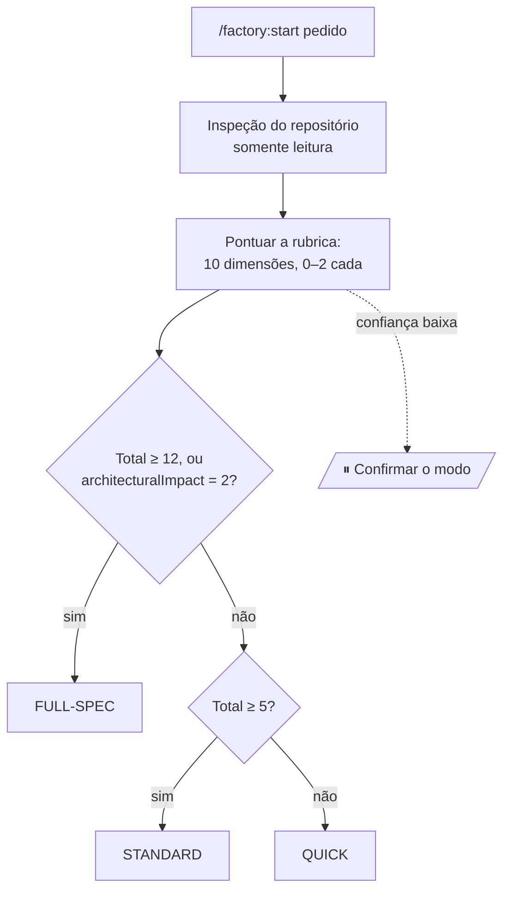
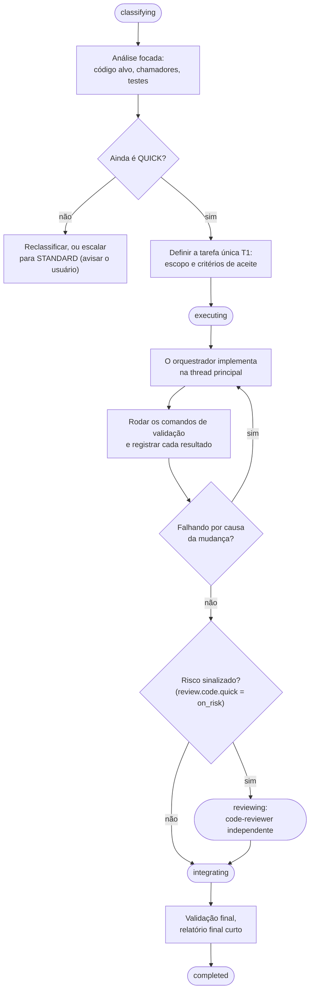
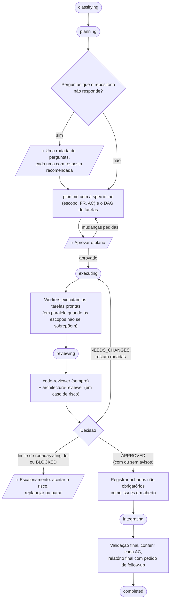
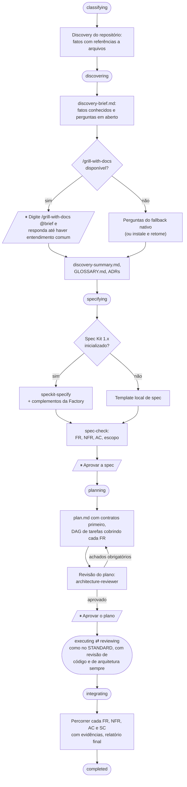
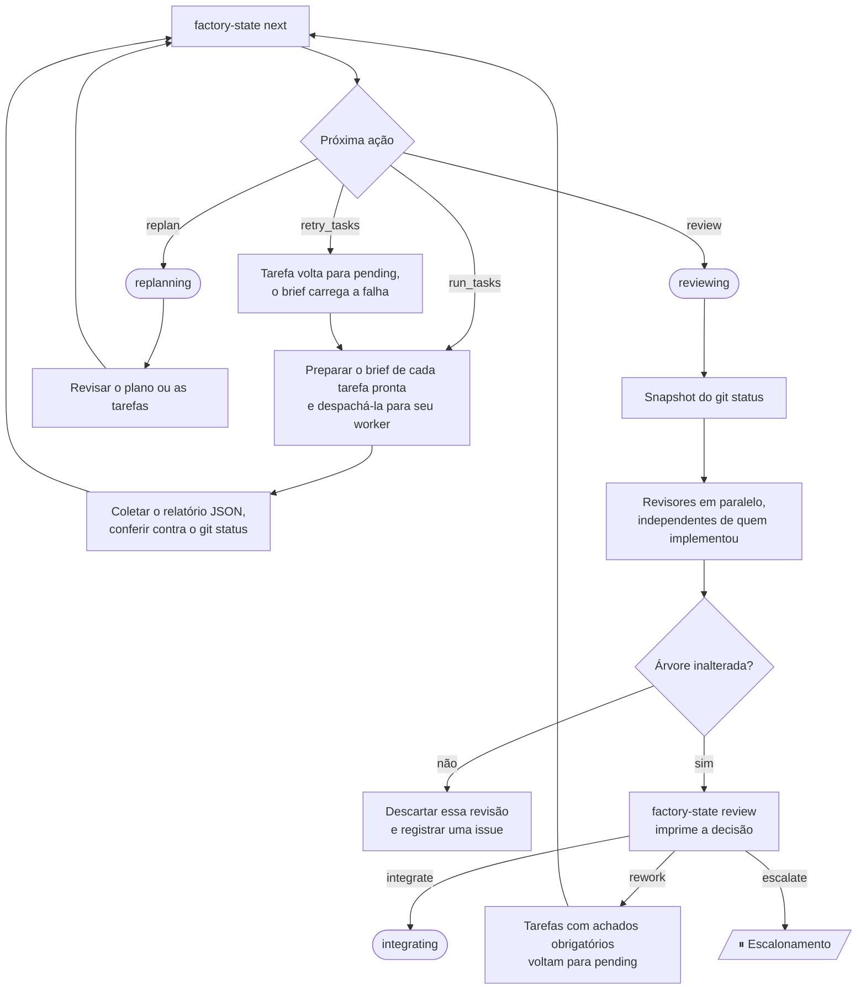
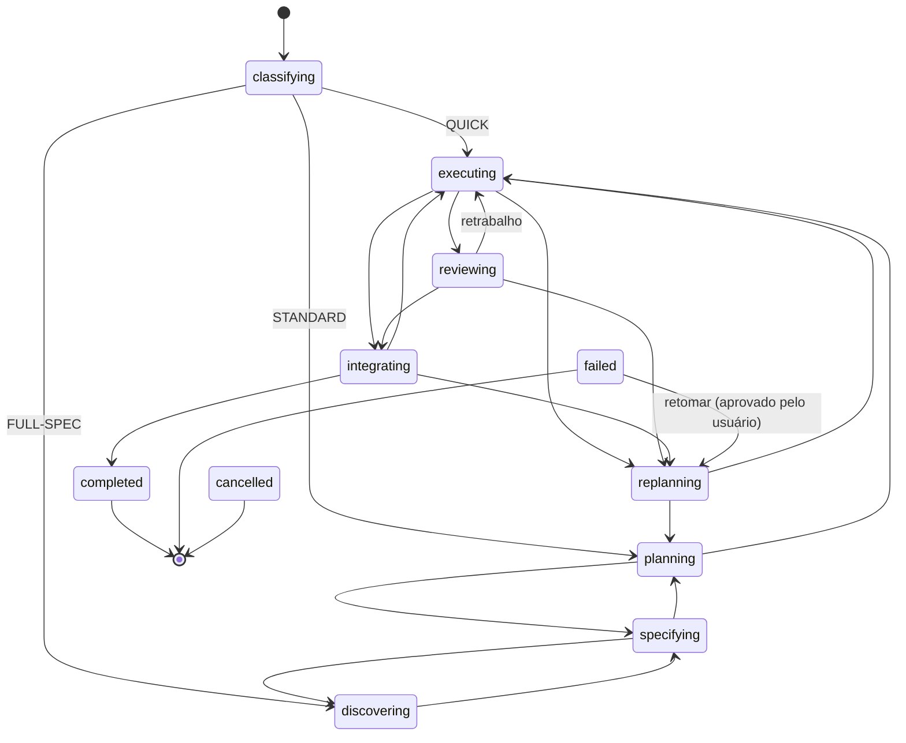

[English](workflows.md) · **Português (Brasil)**

# Diagramas de workflow

Estes diagramas seguem os procedimentos de runtime em `plugins/factory/core/workflows/` (`quick.md`, `standard.md`, `full-spec.md`, `execution.md`, `review.md`). Se um diagrama e um procedimento discordarem, o procedimento está certo.

**Legenda**
- Caixas arredondadas são **status** do workflow, como armazenados no manifest.
- ⏸ marca uma **pausa para você**. O workflow registra `blockedOn`, diz exatamente o que precisa, e você continua com `/factory:resume [id] <resposta>`.
- Qualquer etapa também pode pausar quando precisa de uma decisão que não aparece aqui, por exemplo um comando que precisa da sua aprovação ou uma negação do guard.

## 1. Classificação: qual modo roda

- Os limiares e as dimensões de escalonamento vêm de `classification` na config. Os defaults são os mostrados acima.
- `--mode quick|standard|full_spec` força um modo, e o modo forçado é registrado com o motivo.
- A incerteza só conta quando o repositório não consegue resolvê-la. Um pedido que explicita suas decisões pontua menos: na fase 9, a mesma funcionalidade pontuou FULL-SPEC 15 quando descrita de forma vaga e STANDARD 10 depois que suas decisões foram explicitadas.

## 2. QUICK

Mudanças pequenas e isoladas. Não há documento de plano nem delegação: o próprio orquestrador implementa a mudança.

- Um escalonamento depois que a execução começou passa por `replanning → planning` com `--mode standard`.
- Como o orquestrador implementa, uma revisão, quando obrigatória, precisa ir para o `factory:code-reviewer`. O orquestrador nunca revisa o próprio trabalho.

## 3. STANDARD

Funcionalidades moderadas que tocam vários arquivos ou componentes. Um plano leve, workers para as tarefas e uma revisão independente.

- A execução e a revisão são detalhadas no §5.
- O limite de rodadas é `review.maxIterations`, 3 por padrão.
- Um critério de aceite não atendido bloqueia a conclusão, a menos que você o aceite.

## 4. FULL-SPEC

Trabalho arquitetural, entre domínios ou incerto. O discovery vem antes da especificação, a especificação antes do planejamento, e o planejamento antes de qualquer código. **O código do produto não é alterado antes de você aprovar o plano.**

- O discovery pode escrever documentos de domínio (`GLOSSARY.md`, ADRs) e nada mais.
- Só você pode iniciar o `/grill-with-docs`, e por isso o discovery sempre pausa.

## 5. Ciclo de execução e revisão (STANDARD e FULL-SPEC)

- Uma tarefa que falhou é tentada de novo até `execution.maxTaskAttempts` vezes, 2 por padrão. Depois disso suas dependentes ficam bloqueadas e o `next` pede um replanejamento.
- Um worker que recebe uma negação do "Factory guard" para e reporta `blocked`. Ele nunca contorna a negação.

## 6. Modelo de status

- Todo status aberto também pode ir para `failed` ou `cancelled`. Essas transições foram omitidas do diagrama para facilitar a leitura.
- `failed` significa que o trabalho não pôde ser feito. Ele pode ser retomado para `replanning` com a sua aprovação.
- `cancelled` significa que você abandonou o workflow. Exige `--user-approved` e é final.
- `completed` é final. Follow-ups iniciam um novo workflow: veja [uso](usage.pt-br.md#após-a-conclusão-follow-ups).
- Tabela completa de transições: [contrato de workflow-state](../contracts/workflow-state.md) (em inglês).
